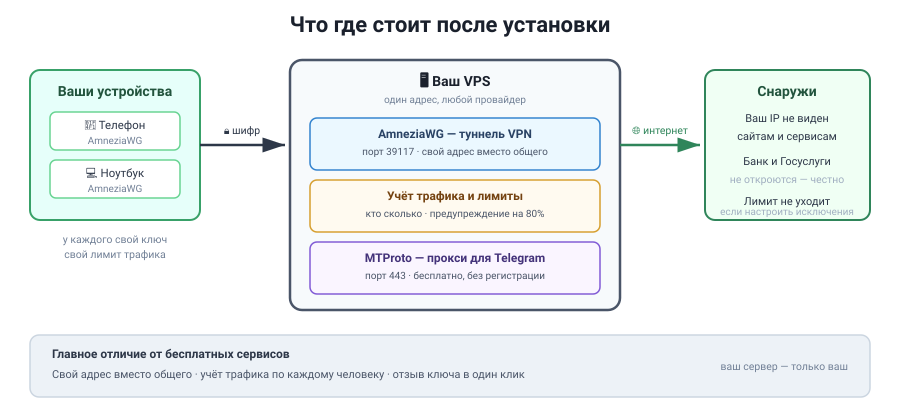
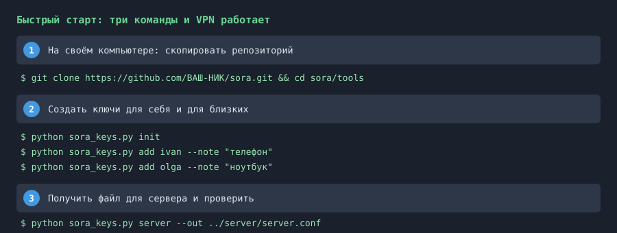

<h1 align="center">SORA — личный VPN на своём сервере</h1>

<p align="center">
  <b>Свой адрес вместо общего. Учёт трафика по каждому человеку. Отзыв ключа в один клик.</b>
</p>

<p align="center">
  
</p>

---

## Что это

Cloudflare WARP у вас уже работает, бесплатно и быстро. Он даёт **общий**
адрес — такой же, как у всех, кто пользуется WARP.

SORA — это VPN **на вашем собственном сервере**. Что это даёт:

| | WARP (бесплатно) | SORA |
|---|---|---|
| Адрес в интернете | общий на всех | **ваш личный** |
| Кто ещё видит ваш трафик | оператор, провайдер | оператор, провайдер |
| Учёт трафика | нет | **по каждому ключу** |
| Лимит на человека | нет | **ставите вы** |
| Отзыв ключа | нет | **да, одна команда** |
| Сколько стоит | 0 ₽ | стоимость вашего VPS |

**Что SORA не делает.** Не скрывает вас от вашего провайдера и не от
государства. VPN защищает канал до сервера и меняет ваш адрес. Всё, что вы
делаете внутри туннеля, видно тому, кто стоит за точкой выхода — то есть
вашему VPS-провайдеру.

**Честно про банки.** Через ключ банк и Госуслуги **не откроются** — не
замедлятся, а именно не установят соединение. Это свойство любого
зарубежного адреса, и мы не делаем вид, что его нет. Что делать вместо
этого — написано в инструкции, шаг «Настройте исключения».

---

## Быстрый старт

Три команды. Если вы можете открыть терминал и вставить строку — этого
достаточно.

<p align="center">
  
</p>

Полная версия шагов — [docs/БЫСТРЫЙ-СТАРТ.md](docs/БЫСТРЫЙ-СТАРТ.md).
Разжёванная установка с картинками и объяснениями каждой строки —
[docs/УСТАНОВКА-ПО-ШАГАМ.md](docs/УСТАНОВКА-ПО-ШАГАМ.md).

### Что нужно

1. **VPS** — виртуальный сервер с Ubuntu или Debian. Подойдёт любой,
   от 1 ГБ памяти. Список провайдеров — в инструкции по установке.
2. **Компьютер**, где будете генерировать ключи. Python 3.8 или новее.
3. **10 минут.**

Больше ничего не нужно. Ни домена, ни опыта в сетях, ни умения читать
логи.

---

## Что внутри

```
SORA/
  README.md                    этот файл
  ТЗ-SORA.md                   техзадание, если делаете это не для себя

  docs/
    БЫСТРЫЙ-СТАРТ.md           три команды, минимум слов
    УСТАНОВКА-ПО-ШАГАМ.md      полная инструкция с нуля
    TELEGRAM-ПРОКСИ.md         бесплатный прокси для Telegram на том же VPS
    СПРОСИ-ИИ.md               как попросить ИИ помочь, если застряли
    ПРОВЕРКА-КЛЮЧЕЙ.md         стенд проверки чужих ключей
    TELEGRAM-ДОСТУП.md         почему бот молчит с VPS и как это чинится

  tools/                       РАБОТАЕТ НА ВАШЕМ КОМПЬЮТЕРЕ
    sora_keys.py               генератор ключей и конфигов
    sora_doctor.py             25 проверок + отчёт в HTML
    sora_traffic.py            учёт трафика, лимиты, автоотключение
    sora_client_check.py       проверка туннеля с любого устройства
    sora_crypt.py              шифрование файлов, AES-256-GCM
    sora_secrets.py            мастер настройки хранения ключей
    sora_keyscan.py            офлайн-разбор конфигов, без сети
    sora_warpcheck.py          живой стенд проверки в Docker
    sora_telegram.py           доступ к Telegram API с VPS
    find_cyrillic.py           проверка скриптов перед публикацией
    publish_check.py           проверка, что ключи не утёкли
    build_publish.py           сборка версии без ваших ключей

  server/                      ЖИВЁТ НА СЕРВЕРЕ
    install_sora.sh            установка, 15 шагов
    uninstall_sora.sh          полный откат
    sora-health.sh             проверка состояния
    sora-selftest.sh           проверка правильности установки
    sora_backup.sh             резервное копирование ключей
    sora-open-port.sh          открыть порт
    sora-close-port.sh         закрыть порт
    bin/                       готовые бинарники amneziawg-go, awg

  client/                      реестр ключей и конфиги (создаётся сам)
  img/                         схемы для этого файла
```

---

## Три команды, которые вы будете использовать чаще всего

```bash
python sora_doctor.py          # что сломано и что делать
python sora_client_check.py    # туннель работает? есть утечки?
python sora_keys.py list       # кто подключён и сколько качает
```

На сервере:

```bash
sora_traffic.py report         # кто сколько скачал за месяц
sora-health.sh                 # состояние сервера
sora-selftest.sh               # всё ли установилось правильно
```

**Начать с `sora_doctor.py`.** Он сам скажет, что не так, и даст готовую
строку, которую надо вставить.

---

## Установить прокси для Telegram на тот же сервер

MTProto и WEB-прокси для Telegram ставятся на тот же VPS и не мешают
VPN. Телеграм показывает ваш канал выше остальных, если человек
подключается через ваш прокси, — это встроенная плата за то, что вы
подняли своё железо.

Инструкция: [docs/TELEGRAM-ПРОКСИ.md](docs/TELEGRAM-ПРОКСИ.md)

Коротко:

```bash
# на сервере, где уже стоит SORA
systemctl status mtproxy        # должен быть active
```

Ссылку для раздачи получаете одной командой. Никакой регистрации и
подписки.

---

## Если что-то непонятно — спросите ИИ

Не нужно разбираться в сетях. Откройте ChatGPT, Claude, Gemini, Copilot
или любой другой ИИ, вставьте готовый запрос из
[docs/СПРОСИ-ИИ.md](docs/СПРОСИ-ИИ.md) вместе с выводом команды, которая
не сработала, и получите ответ.

Там три готовых запроса: установка, диагностика и разбор ошибки. Плюс
правило, что именно надо прикладывать, чтобы ИИ не выдумывал.

**Это работает лучше, чем поиск в интернете,** потому что ИИ смотрит на
вашу конкретную ошибку, а не на общую статью.

---

## Безопасность

### Секреты

- **Приватные ключи не покидают ваш компьютер** при генерации.
- В репозитории лежат **настоящие по форме, но ничьи** ключи — они
  сгенерированы заново и не подходят ни к какому серверу. Примеры должны
  запускаться, иначе документация врёт.
- В примерах используется адрес `203.0.113.10` из подсети, зарезервированной
  в RFC 5737 специально для документации. Использовать её в живой сети
  запрещено, так что подставить свой адрес надо обязательно.

Перед публикацией своей версии прогоните:

```bash
python tools/publish_check.py
python tools/build_publish.py
```

### Ваш VPS — это вы

Кто имеет ваш SSH-ключ, тот имеет сервер. Проверяйте, кому выдали
доступ, и отзывайте ключи у тех, кто больше не нужен.

---

## Проверка чужих ключей

Скачали конфиги WARP и хотите понять, что с ними? Есть два инструмента.

**Офлайн.** Сети не требует вообще — в коде нет ни одного сетевого вызова.

```bash
python tools/sora_keyscan.py C:/путь/к/конфигам
```

**Живой стенд.** Поднимает настоящий туннель в одноразовом контейнере и
гасит его. Сеть вашей машины не затрагивается.

```bash
python tools/sora_warpcheck.py example.conf
python tools/sora_warpcheck.py --папка C:/конфиги --только-уникальные
```

Читать вердикт надо аккуратно: стенд отвечает на вопрос «**отвечает ли
сервер с этого адреса**», а не «работает ли ключ». Часть публичных
генераторов WARP выдаёт конфиги только на зарегистрированные адреса,
поэтому ключ, исправно работающий с телефона, из контейнера не ответит.

Подробности — [docs/ПРОВЕРКА-КЛЮЧЕЙ.md](docs/ПРОВЕРКА-КЛЮЧЕЙ.md).

---

## Если что-то сломалось

Порядок всегда один:

1. `python sora_doctor.py` на своём компьютере.
2. `sora-health.sh` на сервере.
3. [docs/СПРОСИ-ИИ.md](docs/СПРОСИ-ИИ.md) — с выводом того, что не так.

Проверка скажет, что сломано и какую строку вставить. Если она говорит
«всё в порядке», а проблема есть — не спорьте с прибором, а ищите
живую проверку: выключить туннель и открыть сайт.

---

## Лицензия

Свободное ПО. Используйте, меняйте, публикуйте. Продавать установку
можно, продавать чужие ключи — нельзя.

---

<p align="center">
  <sub>
    Сделано для тех, кому надоел общий адрес на всех.<br>
    Вопросы — в Issues репозитория.
  </sub>
</p>